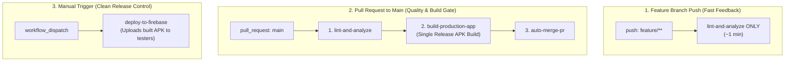

# Manikutti Mobile Client

A premium, offline-first mobile companion for the **Manikutti Finance Tracker** built using **Flutter**. It allows family members to track their personal and family expenses, synchronize data with Google Sheets via a Next.js serverless backend, and work completely offline when network connection is unavailable.

---

## ✨ Features

- **Offline-First Storage**: Saves all transactions locally in a secure SQLite database to prevent lag and ensure it works without internet access.
- **Background Synchronization**: Detects network connectivity changes, automatically pushing local offline edits to Google Sheets and pulling remote updates.
- **UTC Timezone Normalization**: Automatically converts all timestamps to UTC before performing duplicate checks, neutralizing timezone offsets between local devices (e.g., IST) and Vercel servers (UTC).
- **Interactive Ledger UI**: Modern UI featuring net savings metrics, category badges, dynamic charts, filter chips, and automated sync indicators.
- **Secure Authentication**: Verification via email OTP (one-time passwords) that issues stateless JWT credentials.

---

## 🛠️ Getting Started

### Prerequisites
- **Flutter SDK**: Ensure you have Flutter version `3.18.0` or higher installed.
- **Dart SDK**: Clean environment setup with package dependencies resolved.
- **Android Studio / Xcode**: Formats and builds debug/release payloads.

### Installation & Run
1. Navigate to the mobile project directory:
   ```bash
   cd manikutti_mobile
   ```
2. Fetch package dependencies:
   ```bash
   flutter pub get
   ```
3. Connect a physical Android/iOS phone (with USB Debugging active) or start an emulator.
4. Run the application:
   ```bash
   flutter run
   ```

---

## 🚀 CI/CD Pipeline Blueprint & Engineering Standards

This project implements an enterprise-grade, single-run CI/CD workflow designed for high developer velocity, zero wasted runner minutes, and clean distribution history.

### 📐 Pipeline Architecture Blueprint



### 💡 Key CI/CD Architectural Highlights

- **⚡ Fast Developer Feedback (~1 Min)**: Direct pushes to `feature/**` branches execute only lightweight linting, formatting (`dart format`), and static analysis (`flutter analyze`). This gives immediate feedback on syntax without wasting 7+ minutes compiling native Android APKs.
- **🛡️ Quality & Build Protection Gate**: Pull Requests targeting `main` enforce a mandatory quality gate that runs static analysis, unit tests, and compiles the signed release APK. If compilation or signing fails, auto-merge is blocked to protect `main`.
- **📦 Build-Once, Deploy-Anywhere (Artifact Promotion)**: The production release APK is compiled once during PR validation and saved as a workflow artifact (`actions/upload-artifact@v4`). Deployments reuse this exact verified binary without rebuilding.
- **🎯 Clean Firebase Release History**: Firebase App Distribution is triggered on-demand via `workflow_dispatch`, preventing temporary WIP builds from polluting active tester release logs.
- **⏱️ 80% Reduction in Runner Usage**: Eliminates duplicate post-merge runs and redundant APK builds, saving ~8–10 minutes of GitHub Actions runner execution per PR.
