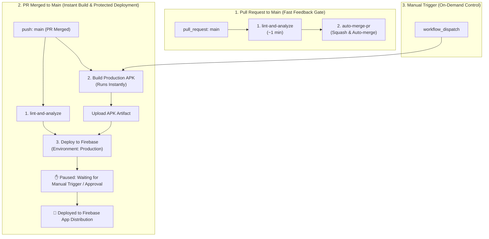

# Manikutti Mobile Client

A premium, offline-first mobile companion for the **Manikutti Finance Tracker** built using **Flutter**. It allows family members to track their personal and family expenses, synchronize data with Google Sheets via a Next.js serverless backend, and work completely offline when network connection is unavailable.

---

## ✨ Features

- **Offline-First Storage**: Saves all transactions locally in a secure SQLite database to prevent lag and ensure it works without internet access.
- **Background Synchronization**: Detects network connectivity changes, automatically pushing local offline edits to Google Sheets and pulling remote updates.
- **UTC Timezone Normalization**: Automatically converts all timestamps to UTC before performing duplicate checks, neutralizing timezone offsets between local devices (e.g., IST) and Vercel servers (UTC).
- **Interactive Ledger UI**: Modern UI featuring net savings metrics, category badges, dynamic charts, filter chips, and automated sync indicators.
- **Secure Authentication**: Verification via email OTP (one-time passwords) that issues stateless JWT credentials.

---

## 🛠️ Getting Started

### Prerequisites
- **Flutter SDK**: Ensure you have Flutter version `3.18.0` or higher installed.
- **Dart SDK**: Clean environment setup with package dependencies resolved.
- **Android Studio / Xcode**: Formats and builds debug/release payloads.

### Installation & Run
1. Navigate to the mobile project directory:
   ```bash
   cd manikutti_mobile
   ```
2. Fetch package dependencies:
   ```bash
   flutter pub get
   ```
3. Connect a physical Android/iOS phone (with USB Debugging active) or start an emulator.
4. Run the application:
   ```bash
   flutter run
   ```

---

## 🚀 CI/CD Pipeline Blueprint & Engineering Standards

This project implements an enterprise-grade, single-run CI/CD workflow designed for high developer velocity, zero wasted runner minutes, and clean distribution history.

### 📐 Pipeline Architecture Blueprint



### 💡 Key CI/CD Architectural Highlights

- **⚡ Instant Build on Merge**: When a PR merges into `main`, the `Build Production APK` job triggers immediately without blocking on prior sequential gates, compiling the signed release APK against the merged `main` branch.
- **🛡️ Quality Gate on Pull Requests**: Pull requests targeting `main` execute static analysis (`flutter analyze`), formatting checks (`dart format`), and unit tests (`flutter test`) in ~1 minute, ensuring high code quality before merging.
- **✋ Manual Deployment Gate**: Deployment to Firebase App Distribution is protected by GitHub's native `Production` Environment approval rule. Once the APK build completes, the pipeline waits in a paused state for an authorized reviewer to click "Approve and deploy".
- **📦 Artifact Reuse**: When deployment is approved, the exact release APK compiled in the build step is downloaded from GitHub Actions artifacts and uploaded directly to Firebase App Distribution—preventing duplicate compilation runs.
